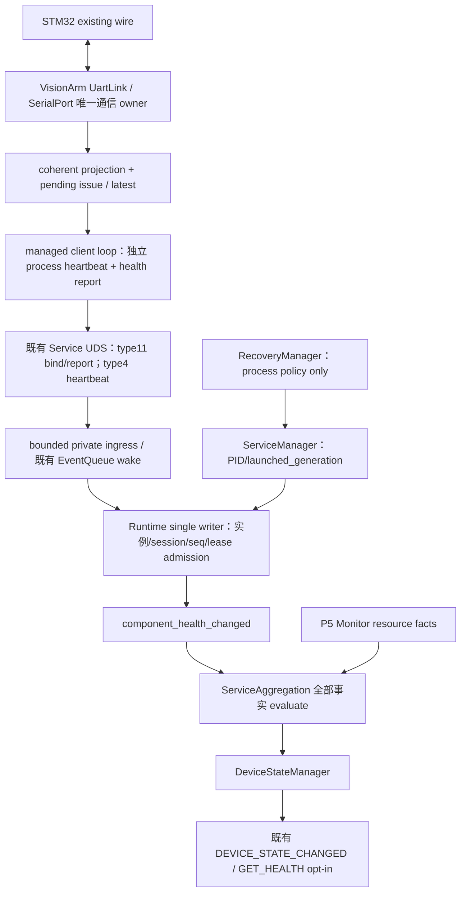

# Phase6 Architecture

UDS report 是健康传输，UART wire不改变。Runtime无需链接VisionArm协议库；component模型无UART includes。跨repo合同以docs/P6及JSON fixture冻结，不复制内部头或引入 shared SDK framework。

## 并发和资源

现有 UART I/O thread 唯一改通信状态；新增 projection 在相同owner互斥域同步复制，网络I/O不可持有其锁。
VisionArm 需要一个 managed client event loop（一个线程，非每component/每service线程），处理UDS非阻塞connect/read/write、process heartbeat每1s、projection检查每100ms、状态变化报告和每1s续租。现有产品主loop含业务阻塞，不能承诺在该loop里及时发心跳；故不借用camera/control callback。这个线程证明报告进程的管理loop存活，不证明摄像或推理业务健康，业务失败仍按现有fatal/lifecycle退出。

Runtime IPC epoll只校验格式/peer捕获并向私有bounded ingress提交；writer绑定、重验证和聚合。复用现有writer turn检查lease，不增MCU watchdog/Monitor采样线程。report freshness是IPC观测可用性，非wire receive timeout。

常态每1s一份小report+一份process heartbeat，状态变化及时报告。只有status/故障episode/boot证据变更进dispatcher，纯续租不重新触发DeviceState。每component一个current、一个待确认issue、一个inflight，memory-only O(C)，本期仅mcu_link。

## 原P4/P5保护

不改 process backend、五次reservation、exec-based recovery success、cancel/manual/dependency closure、OFFLINE latch。P5 native/external、资源source准入/迟滞/独占reap/采样线程保留。
DSM允许矩阵保持24/417；只调整aggregation对component事实的判断与reconcile触发选择，仍由DSM验证。
正常shutdown冻结设备末快照，不用link CLOSED伪OFFLINE。
